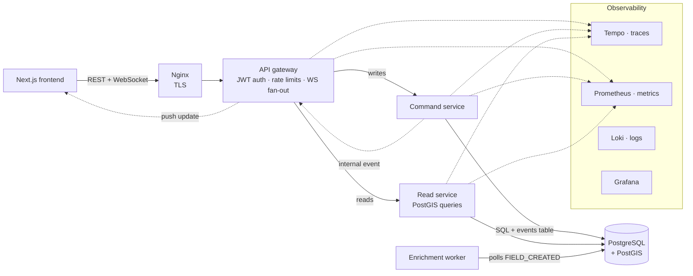

# FieldFlow

[](https://github.com/afrid09/FieldFlow/actions/workflows/ci.yml)

A multi-service platform for managing farm fields: map them, track soil and weather data, run geospatial queries, and get automatic analysis when a field is created. It's built the way I'd build a production backend: separate read and write services, an API gateway, a background worker, and the observability, backup and deployment tooling to run it.

TypeScript · Node/Express · Next.js · PostgreSQL + PostGIS · Docker · Kubernetes/Helm · OpenTelemetry · Prometheus/Grafana/Loki/Tempo

## Architecture



| Component | Responsibility |
|---|---|
| **API gateway** | Single entry point: verifies JWTs, applies rate limits, routes writes and reads, and pushes realtime events to browsers over WebSockets |
| **Command service** | All writes (fields, soil and weather readings, analysis) and auth. Every change is also recorded in an `events` table |
| **Read service** | All queries, including geospatial ones: bounding box, polygon, nearby and nearest fields, backed by GiST indexes |
| **Enrichment worker** | Picks up `FIELD_CREATED` events and writes an initial analysis for the new field |
| **Frontend** | Next.js dashboard with a Leaflet map, live updates and role-based views |

More detail: [architecture](docs/architecture.md) · [observability](docs/observability.md) · [testing](docs/testing.md) · [migrations](docs/migrations.md) · [disaster recovery](docs/disaster-recovery.md) · [infra hardening](docs/infra-hardening.md) · [secrets](docs/secrets-management.md) · [configuration](docs/configuration.md)

## Quick start

```bash
docker compose up --build
```

This starts PostGIS, runs migrations and dev seeds, and brings up every service plus the observability stack.

| URL | What |
|---|---|
| http://localhost:3002 | App: sign in with `demo@fieldflow.com` / `demo123` |
| http://localhost:3000/health | API gateway |
| http://localhost:3004 | Grafana (`admin` / `admin`): dashboards, logs and traces |
| http://localhost:9090 | Prometheus |

Roles: **admin** has full access, **manager** can create farmer accounts, **farmer** sees and edits only their own fields.

## Design decisions and trade-offs

**Separate read and write services (CQRS-style).** Writes and reads have different shapes here: writes are small and transactional, reads are heavy geospatial queries. Splitting them lets each scale and be tuned on its own, such as adding read replicas behind the read service. *Trade-off:* both still share one database, so this is a service split rather than full CQRS with separate read models. That keeps consistency simple (reads see writes immediately) at the cost of not isolating read load from the primary.

**Auth checked at the gateway and again in each service.** The gateway rejects bad tokens before they reach anything else, and each service verifies the JWT again and enforces row ownership, so a farmer can't read another farmer's fields even if a request reaches a service directly. *Trade-off:* every service needs the signing secret and pays for a second verification. With more services I'd move to asymmetric keys (services hold only the public key) or mTLS between services.

**An events table, and a polling worker.** Every write appends to `events`, which serves as an audit trail and as the enrichment worker's queue. Because the event is written in the same transaction as the change, a committed field always gets enriched. *Trade-off:* polling adds up to one interval of latency (10s by default) and isn't safe to run as several instances yet. At larger scale I'd claim rows with `FOR UPDATE SKIP LOCKED`, or publish the same events to Kafka through a transactional outbox, as in [reliable-orders](https://github.com/afrid09/reliable-orders).

**Realtime via the gateway.** Services notify the gateway after a write, and the gateway pushes to connected browsers, which refetch only what changed. *Trade-off:* the gateway keeps WebSocket clients in memory, so with more than one gateway replica you need sticky sessions or a shared pub/sub such as Redis.

**PostGIS instead of doing geometry in the app.** Spatial filters run in the database with GiST indexes, so the read service never loads all fields to filter them in code.

**Operability built in.** Structured logs (pino), Prometheus metrics on every service, OpenTelemetry traces to Tempo, alert rules, nightly `pg_dump` backups with an automated restore-validation job, and runbooks for service-down and backup-failure incidents.

## What I'd change at scale

- Read replicas for the read service, and a separate read model for the dashboard aggregates
- Kafka with a transactional outbox instead of the polling worker, with idempotent consumers
- Redis pub/sub so the gateway can scale horizontally
- Partition the soil and weather time-series tables by month

## Testing

| Layer | Tooling | Runs in CI |
|---|---|---|
| Unit | Jest, React Testing Library | ✅ |
| Integration | Jest + Supertest against PostGIS | ✅ |
| End-to-end | Playwright against the full Docker stack | ✅ |

See [docs/testing.md](docs/testing.md) for how to run each locally.

## Deployment

- **Docker Compose** for local development (above)
- **Kubernetes** manifests in [`infra/k8s/`](infra/k8s) with HPA, PodDisruptionBudgets, network policies, cert-manager TLS and backup CronJobs
- **Helm** chart in [`helm/fieldflow/`](helm/fieldflow)
- **Secrets** from AWS Secrets Manager via External Secrets and IRSA ([guide](docs/secrets-management.md))

## Repository layout

```
frontend/                 Next.js app (+ Playwright e2e tests)
services/
  api-gateway/            Auth, routing, rate limiting, WebSocket fan-out
  command-service/        Writes, auth endpoints, migrations and seeds
  read-service/           Queries and PostGIS geo endpoints
  enrichment-service/     Background analysis worker
infra/
  migrations/  seeds/     Schema and data
  k8s/  nginx/  postgres/ Deployment, TLS, backups
  observability/          Prometheus, Grafana, Loki, Tempo config
helm/fieldflow/           Helm chart
docs/                     Architecture, runbooks and guides
```
